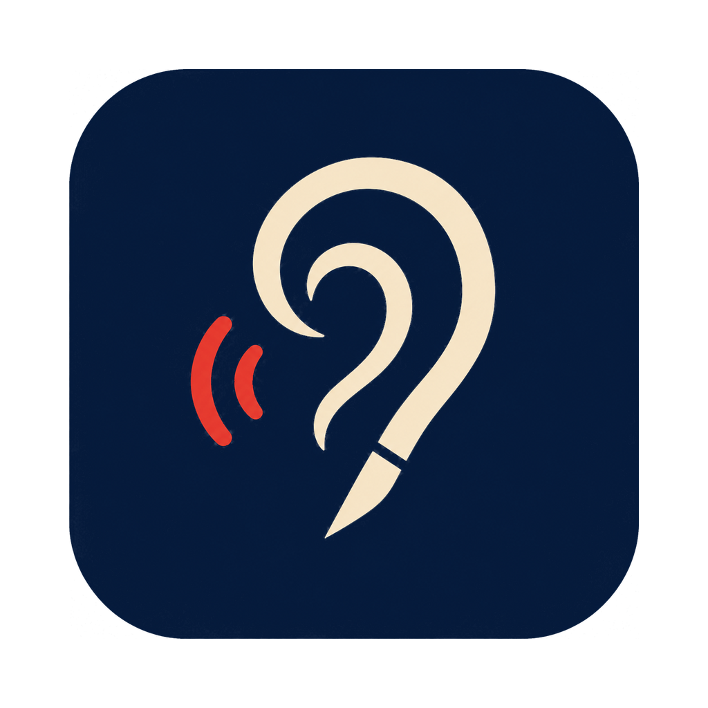

# kikigaki

日本語特化・完全ローカルのプッシュトゥトーク型音声入力アプリ(macOS/Windows)。

Fast, private Japanese voice typing. 100% local and open source.

聞き取りキー(macOSでは `Alt+Space`、Windowsでは `Ctrl+Alt+Space`)を押しながら話し、キーを離すと認識結果が最前面のアプリにペーストされる。

- 音声認識・発話区間検出・句読点付与をすべて端末内で実行
- 既定ではモデルの初回ダウンロードを除きネットワークを使わない
- 置換辞書でカタカナ語や固有名詞を好みの表記に変換
- 無料・オープンソース(MIT)

## インストール (macOS)

[Releases](https://github.com/HiroshigeAoki/kikigaki/releases)から `kikigaki-<version>-macos-arm64.dmg` をダウンロードして開き、`kikigaki.app` をApplicationsにドラッグする。

未公証のため、初回起動は「"kikigaki" にマルウェアが含まれていないことを確認できませんでした」と表示されてブロックされる。システム設定 → プライバシーとセキュリティ → セキュリティ欄の **このまま開く** から起動する。必要なのはインストールごとに一度だけ(macOS 15以降、未公証アプリを右クリック → 開くで起動する方法は廃止された)。ターミナルからなら次のコマンドでも同じ。

```bash
xattr -d com.apple.quarantine /Applications/kikigaki.app
```

初回起動時はオンボーディング画面が開き、マイク権限 → アクセシビリティ権限 → モデルのダウンロードの順に進む。ダウンロードするのはモデルデータのみで約480 MB(HaasとSilero VAD)。ONNX Runtimeはアプリに同梱している。リリースは固定の自己署名IDで署名しているため、許可した権限はアップデート後も保持される。

## インストール (Windows)

[Releases](https://github.com/HiroshigeAoki/kikigaki/releases)から `kikigaki-<version>-windows-x64-setup.exe` をダウンロードして実行する。管理者権限は不要で、現在のユーザーのみにインストールされる。署名はしていないため、SmartScreenの警告が出た場合は「詳細情報」→「実行」で起動する。

初回起動時はオンボーディング画面が開き、マイク権限の確認 → モデルのダウンロードの順に進む。アクセシビリティ権限の確認手順はない。ダウンロードするのはモデルデータのみで約480 MB(HaasとSilero VAD)。ONNX Runtimeはアプリに同梱している。ホットキーの既定は `Ctrl+Alt+Space`（`Alt+Space` はWindowsのシステムメニューやPowerToys Runと競合するため）。

## プライバシー

音声認識(HaasまたはReazonSpeech)、発話区間検出(Silero VAD)、句読点付与は、すべて端末上で実行される。Haasは自身で句読点を出力し、mojicastの句読点モデルは使わない。ReazonSpeechではmojicastで句読点を付与する。既定構成でネットワークを使うのはモデルの初回ダウンロードだけで、音声データや認識結果を外部サーバーへ送信しない。`remote-engine` 構成でも、既定では同一マシン上のローカルプロセス(`ws://127.0.0.1`)に接続する。

## ファイルの場所

| 項目 | macOS | Windows |
| --- | --- | --- |
| 設定 | `~/.config/kikigaki/config.toml` | `%APPDATA%\kikigaki\config.toml` |
| 置換辞書 | `~/.config/kikigaki/replace.toml` | `%APPDATA%\kikigaki\replace.toml` |
| モデル | `~/Library/Application Support/kikigaki/models` | `%LOCALAPPDATA%\kikigaki\models` |
| ログ | `~/Library/Logs/kikigaki/kikigaki.<date>.log` | `%LOCALAPPDATA%\kikigaki\logs\kikigaki.<date>.log` |
| レイテンシ計測 | `~/Library/Logs/kikigaki/latency.jsonl` | `%LOCALAPPDATA%\kikigaki\logs\latency.jsonl` |

## 設定

設定ファイルは任意。省略した項目はすべて既定値のまま動く。全項目の一覧と既定値は [`docs/configuration.md`](docs/configuration.md) に記載している。

### 認識モデル

設定画面の「認識モデル」で、聞き取りキーが使うモデルを「ReazonSpeech」と「Haas」(Haas-ja v1.0、既定)から選べる。

以前からkikigakiを使っていてモデルを選んだことがない環境では、ReazonSpeechだけが入っている間はReazonSpeechを使い続ける。Haasのモデルがすでに入っている場合はHaasを使う。設定画面でHaasを選ぶと切り替わる。ReazonSpeechを使い続けたい場合は、設定画面で「ReazonSpeech」を選ぶ。選んだモデルは設定ファイルの `[asr]` の `model` に保存される。

- Haasは一般的な日本語の読み上げ音声で誤りが約半分になる。FLEURS日本語テストセットの文字誤り率はHaasが4.8%、ReazonSpeechが9.0%で、固有名詞や専門用語にも強い
- ReazonSpeechはキーを離してから貼り付けまで約0.2秒。Haasはそれより遅く、Apple Silicon搭載Macで短い発話なら約0.4秒が目安となる
- Haasは初回に約480 MBをダウンロードし、実行中は約0.9 GBのメモリを使う
- 切り替えはkikigakiの次の起動から反映される。ReazonSpeechに戻す場合も同じ
- Haasは自身で句読点を出力し、聞き取りキーに句読点モデルを適用しないため、末尾の文に必ずしも「。」が付くわけではない

### 置換辞書

上の表の置換辞書ファイルに `[[rule]]` を書くと、認識結果を文字列置換できる。ファイルの変更は自動で反映される。

```toml
[[rule]]
from = ["クバネティス", "クーバネティス"]
to = "Kubernetes"
```

一致した認識結果はすべて置換されるため、同音異義語や一般的な単語は避けること。

クバネティス→Kubernetesのように変換するカタカナ語→英語の内蔵辞書も利用できる。既定では無効で、設定画面の「カタカナ語→英語辞書」または設定項目 `builtin_replace_dict` で有効にする。設定画面のトグルを有効にすると、置換に加えて、内蔵辞書に登録された読みを認識しやすくするバイアスも適用される。手元の評価では、対象用語の再現率がおよそ2倍になった。`replace.toml` のユーザー定義ルールと学習済みの修正は、常に内蔵辞書より優先される。

## ロードマップ

- [x] macOS(Apple Silicon)
- [x] プッシュトゥトーク入力
- [x] 日本語の音声認識(ReazonSpeech)
- [x] 自動句読点
- [x] 置換辞書
- [x] カタカナ語の既定置換辞書
- [ ] 認識精度の改善
- [ ] Windows対応

## 開発

`scripts/mac-sync-build.sh` でビルド用Macへソースを同期してビルドし、Mac側で `open target/release/bundle/macos/kikigaki.app` を実行する。ログは `tail -f ~/Library/Logs/kikigaki/kikigaki.*.log` で追える。環境変数 `KIKIGAKI_MODELS_DIR` は実モデルを使うテストツール専用で、GUIの `models_dir` 設定は上書きしない。

自己署名ID `kikigaki` の秘密鍵は、ビルド用Macの専用キーチェーンとメンテナのパスワードマネージャーにのみ存在し、このリポジトリには含まれない。証明書をローテートした場合(現行の有効期限は2036-08)、次のアップデート後にマイクとアクセシビリティの許可が一度ずつ再要求される。影響はそれだけ。

## クレジット

| プロジェクト | ライセンス | 用途 |
| --- | --- | --- |
| [sherpa-onnx](https://github.com/k2-fsa/sherpa-onnx) | Apache-2.0 | 音声認識・VADの実行エンジン |
| [ReazonSpeech](https://research.reazon.jp/projects/ReazonSpeech/) | Apache-2.0(モデル) | 日本語の音声認識モデル |
| [Haas-ja v1.0](https://huggingface.co/third-intelligence/Haas-ja-v1.0) | Apache-2.0(モデル) | 高精度な日本語の音声認識モデル(Third Intelligence) |
| [Haas-ja-v1.0-onnx-quantized](https://huggingface.co/oboroge0/Haas-ja-v1.0-onnx-quantized) | Apache-2.0 | HaasのONNX変換・量子化(oboroge0) |
| [Silero VAD](https://github.com/snakers4/silero-vad) | MIT | 発話区間検出モデル |
| [mojicast-punct-onnx](https://huggingface.co/ishiki-emo/mojicast-punct-onnx) | Apache-2.0(モデル) | 句読点付与モデル |
| [ONNX Runtime](https://github.com/microsoft/onnxruntime) | MIT | 句読点モデルの実行 |
| [hayamimi](https://github.com/oboroge0/hayamimi) | MIT | 句読点パイプラインの移植元 |
| [mecab-ipadic-NEologd](https://github.com/neologd/mecab-ipadic-neologd) | Apache-2.0 | 内蔵カタカナ語→英語辞書のデータ |
| [Wikidata](https://www.wikidata.org) | CC0 1.0 | 内蔵カタカナ語→英語辞書のデータ |
| [japanese-dev-lingo](https://github.com/Wizcorp/japanese-dev-lingo) | MIT | 内蔵カタカナ語→英語辞書のデータ |

静的ライブラリの一覧と追加のライセンス情報は [NOTICE](NOTICE) に記載している。
