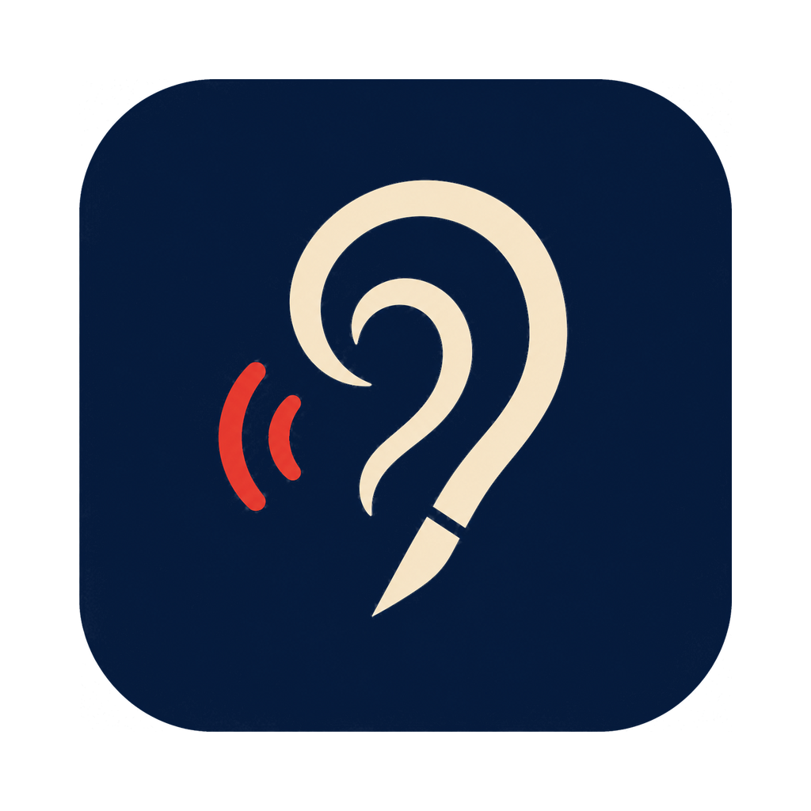

# kikigaki アイコン



濃紺・生成り・朱色の配色で「聞く・書く」を表すアイコン。耳と筆先を1つの線にまとめている。

## 原本

`kikigaki-icon-source.png` は承認された生成画像をそのまま保存したもの（1254 × 1254、RGB PNG）。透過チャンネルはなく、角丸の外側は黒い。形と配色は変えず、派生画像はすべてこの原本から生成する。

## 派生画像

`scripts/icons/make_icons.py` が原本から次のファイルを生成する。

| ファイル | 用途 |
| --- | --- |
| `docs/branding/kikigaki-icon-master-1024.png` | 配布用マスター。1024 × 1024、角丸の外側は透過、本体は824 × 824で中央に配置（Appleのアイコングリッド準拠、影なし） |
| `docs/branding/social-preview.png` | GitHubのソーシャルプレビュー（1280 × 640） |
| `crates/kikigaki/icons/32x32.png` ほか | Tauriの `bundle.icon` が参照するPNG（32、128、256、512） |
| `crates/kikigaki/icons/icon.icns` | macOSアプリとDMG用のICNS（16〜1024） |
| `crates/kikigaki/icons/tray/*.png` | メニューバー用の状態別アイコン（36 × 36、18ptの@2x） |

メニューバー用アイコンは、原本から耳と筆先の線だけを抜き出したもの。音の波を表す朱色の弧は、小さく表示すると潰れるため含めない。待機・モデル読込・確定処理・切断はテンプレート画像で、macOSがライト／ダークに合わせて色を変える。録音中だけは朱色の画像を使う。

| 状態 | 表示 |
| --- | --- |
| 待機 | 耳のアイコン |
| モデル読込 | 耳のアイコンを薄く表示 |
| 確定処理 | 小さめの耳のアイコンと下に3つの点 |
| 切断 | 耳のアイコンに斜線 |
| 録音 | 朱色の耳のアイコン |

## 再生成と検証

依存パッケージのバージョンはスクリプト先頭（PEP 723）で固定しており、`uv` が自動で用意する。

```bash
uv run scripts/icons/make_icons.py            # 派生画像をすべて書き出す
uv run scripts/icons/make_icons.py --check    # コミット済みの画像が最新か確認する
uv run scripts/icons/make_icons.py --self-test
```

`scripts/check.sh` は `--self-test` と `--check` を実行する。原本やスクリプトを変えたら再生成して、生成物もあわせてコミットする。

ソーシャルプレビューはAPIで設定できないため、リポジトリの `Settings → General → Social preview` から `social-preview.png` を手動でアップロードする。

## Windows版への流用

Windows版の実装時は `kikigaki-icon-master-1024.png` から `icon.ico` を作り、`bundle.icon` に追加する。Pillowで16、24、32、48、64、128、256のサイズを含めて書き出せる。

```python
from PIL import Image
Image.open("docs/branding/kikigaki-icon-master-1024.png").save(
    "crates/kikigaki/icons/icon.ico",
    sizes=[(16, 16), (24, 24), (32, 32), (48, 48), (64, 64), (128, 128), (256, 256)],
)
```

Windowsのタスクトレイはテンプレート画像の仕組みがないため、トレイ用アイコンは別途用意する必要がある。
